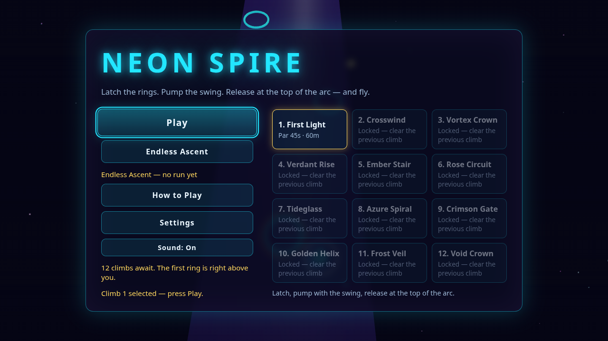
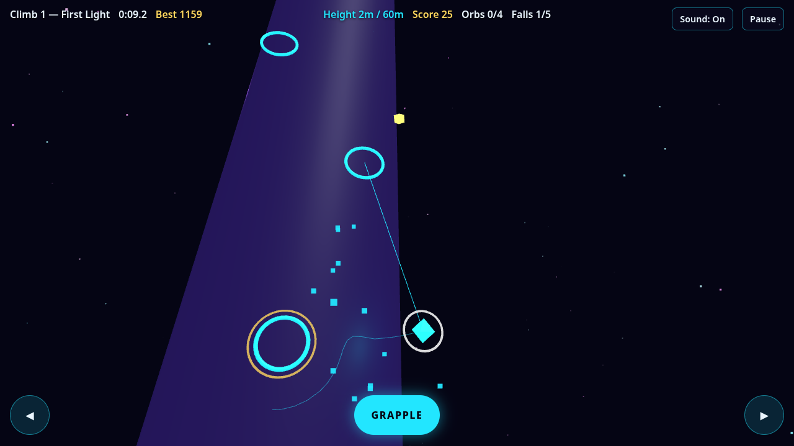
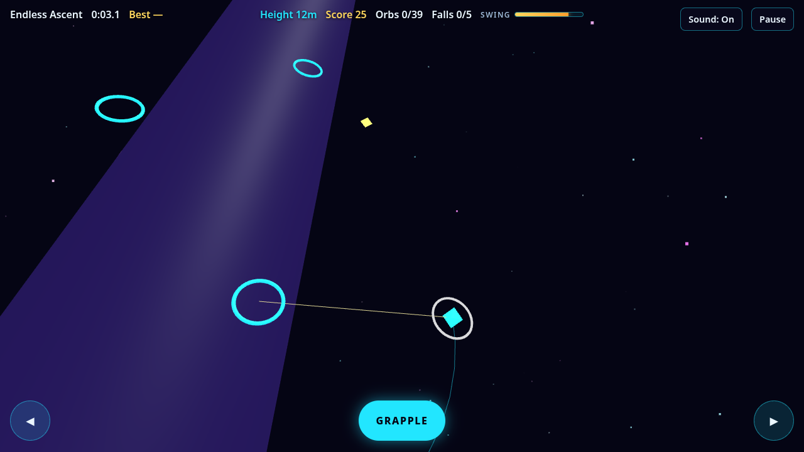

# Neon Spire — 3D Neon Grapple-Climb Ascender

Latch the anchor rings, pump the pendulum swing, release at the top of the arc — and fly up the spire.

**Play it live:** https://namdev-muse.github.io/neon-spire/

## The game

You hang from a grapple rope on the face of a towering neon spire. There is no climbing up by hand — the **swing** is the way up.

- **Hold Space / mouse / GRAPPLE** to latch the nearest anchor ring in reach. The rope only reaches the rings you can actually fly to — no auto-aim, no "release now" prompt.
- **Pump with A / D or Left / Right** in time with the swing — push *with* the motion, not against it — to build amplitude.
- **Release at the top of the arc**, while flying up toward the next ring, and latch it mid-flight. Release too early and you fall back; too late and the swing carries you past.
- Collect **gold orbs** along the good lines for score. Touch a **checkpoint ring** and a fall sends you back there, not to the base.
- Fall below your last checkpoint and you drop back to it. **5 falls** ends the climb. Latch the **gold summit ring** to clear the climb.
- Your **best score** is saved per climb. Clearing a climb unlocks the next one. Ranks: **S** (no falls, under par), **A** (under par), **B** (cleared) — your best rank per climb is saved and shown as a badge on the climb card.
- **Endless Ascent** — a never-ending seeded climb from the menu (same route for everyone each day; `?endless=1` for today, `?endless=<seed>` for a specific seed). Climb as high as you can; **5 falls** ends the run and your best height is saved.

## Climbs (M2: 12)

| # | Climb | Height | Par |
|---|-------|--------|-----|
| 1 | First Light | 60m | 45s |
| 2 | Crosswind | 84m | 60s |
| 3 | Vortex Crown | 102m | 75s |
| 4 | Verdant Rise | 118m | 100s |
| 5 | Ember Stair | 124m | 130s |
| 6 | Rose Circuit | 150m | 135s |
| 7 | Tideglass | 159m | 165s |
| 8 | Azure Spiral | 176m | 175s |
| 9 | Crimson Gate | 186m | 185s |
| 10 | Golden Helix | 196m | 205s |
| 11 | Frost Veil | 206m | 205s |
| 12 | Void Crown | 216m | 210s |

## Controls

- Hold **Space** / mouse button: grapple · drag mouse left/right: pump · **A / D** or **Left / Right**: pump the swing · Release **Space**: let go
- **P**: pause · **M**: mute · **R**: restart
- Touch: hold **GRAPPLE**, hold **◀ / ▶** to pump
- **Esc** closes a panel · **Enter** confirms on menus

## Tech

- Three.js 0.160.0 (pinned, jsdelivr import map), vanilla HTML/CSS/JS, Web Audio API synth SFX, no build step, GitHub Pages from `main` / root.
- Pure simulation core in `physics.js` (no DOM, no Three.js) — deterministic fixed-step pendulum sim, driven through public input hooks by the bot harness.
- Game feel: trauma screen shake (real-time decay), hit-stop, FOV punch + latch dip, latch camera snap, summit slow-mo, pooled particles, score pops, swing-energy meter + rope glow + pitch-rising pump ticks, synth SFX + generative music (Am–F–C–G bass + arpeggio that climbs with you).
- Tests: `npm test` (smoke 102 + bot gates), `npm run render-check` (headless Chromium: menu, demo, accessibility toggles, screen-space pump, pump feedback ticks + swing meter, music active, release/re-latch, autopilot clear, fall/respawn, pause, shake, rest state, Endless Ascent menu + autopilot + banked best + `?endless=` deep links, rank badge on the climb card, `?climb=` unlock path incl. climb 12, M5: FPS guard + Peak height label + HUD pill backdrops + endClimb race regression + settings performance line), `npm run screenshots` (1280x720 / 2560x1080 / 1080x2340, menu + settings + gameplay + pause + climb-5 framing, inspected by eye; refreshes `docs/screenshots/`).

## Version

v0.5.0 (M5 polish & robustness: endClimb race fix, HUD pill backdrops, Peak height label, game-over dialog fix, FPS guard, camera framing fix, settings performance line, How to Play wording). See [docs/DEVLOG.md](docs/DEVLOG.md) for the sprint log.

## Known issues (M5)

- Portrait framing leaves large vertical empty bands above/below the action (same caveat class as Apex/Bastion) — carried to M6.
- The live autopilot clear in the render check took 2 falls (slow-frame timing); the sim bot clears with 0 falls.
- Music/SFX have not had a human-ear check yet (render check proves the scheduler runs and the music is active after Play).
- Climb 10 and 11 sit within 0.1s of each other on the decision bot's clock (58.17s vs 58.27s) — the curve is monotonic but the margin there is thin; a human will feel climb 11 as harder through its wider reversals and taller gaps, but the bot-time gap is small.
- Endless Ascent's live autopilot climb is verified to 25m in the render check; the 100m+ heights are sim-bot evidence only (the bot reaches 355.9m on seed 20261124 in simulation).
- At a wide swing the frame still angles slightly — the M5 camera fix straightened the spire (look target now tracks the camera axis), but a climber swung far off the spire axis still tilts the view a few degrees; cosmetic.
